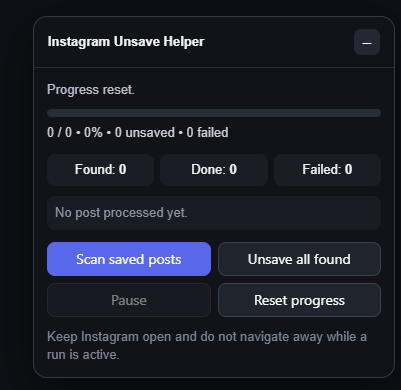

# Instagram Saved Posts Unsave Helper

A Chrome extension that scans your Instagram **Saved** collection and unsaves posts in bulk, with throttling and live progress tracking.

Built with JavaScript, HTML, CSS, Chrome Extension APIs and Manifest V3.



## Features

- **Scan saved posts** to find everything in your Saved collection and track it, skipping duplicates
- **Unsave all found** to remove the scanned posts in one run
- **Pause** and **Reset progress** controls to stay in charge of the process
- **Floating, minimizable control panel** on the page, so everything is one click away
- **Progress tracking** with a progress bar, Found / Done / Failed counters and a status line for the last post processed
- **Rate limiting** between actions to avoid hammering the page
- **Persistent state** with `chrome.storage.local`, so progress is saved

## Installation

1. Download or clone this repository:
   ```bash
   git clone https://github.com/Faizankhan9832/unsave-instagram-extension.git
   ```
2. Open Chrome and go to `chrome://extensions`.
3. Turn on **Developer mode** (top right).
4. Click **Load unpacked** and select the project folder.

## How to use

1. Log in to Instagram and open your **Saved** posts page.
2. The floating control panel appears on the page.
3. Click **Scan saved posts** to find your saved posts.
4. Click **Unsave all found** to start. Use **Pause** to stop temporarily or **Reset progress** to start over.
5. Watch the Found, Done and Failed counters.
6. Keep Instagram open and don't navigate away while a run is active.

## Project structure

The code is split into separate modules, each with one job:

- **Scanning**: finds saved posts and tracks them
- **Actions**: performs the unsave operation
- **State management**: keeps progress in `chrome.storage.local`
- **Rate limiting**: spaces out actions
- **UI**: the floating control panel

## Tech stack

JavaScript (ES6+) · HTML · CSS · Chrome Extension APIs · Manifest V3

## Disclaimer

This is a personal learning project and is not affiliated with Instagram or Meta. It automates actions in your own account, so use it at your own risk and in line with Instagram's terms.

## Author

**Faizan Khan** · [GitHub](https://github.com/Faizankhan9832) · [LinkedIn](https://www.linkedin.com/in/faizan-khan-39247a419/)
